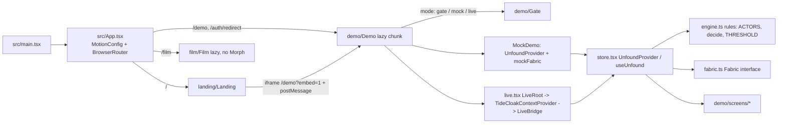

# Repository Guidelines

## Project Overview
Unfound ("Be reached, not found") lets family-violence survivors stay reachable by services (school, GP, court, police) without any staff member, admin, or operator being able to look up her address. The address is sealed in the browser as three tagged parts (`addrfull`, `addrzone`, `addrcontact`) using Tide/TideCloak threshold crypto. Role changes need a 2-of-3 admin quorum.

The repo contains:
- a single Vite + React SPA with a landing page, an interactive demo, and a frame-renderable film;
- pitch and brief material in `docs/`;
- local TideCloak setup scripts.

The public build and the film run on the **mock fabric**. Since PR #7 (merged 1 Nov 2026), the live TideCloak path provisions, enrols, and grants roles against a local realm; persona sign-in and cross-user decryption (survivor seals, school opens) are not yet verified. The README and Gate copy still say enrolment failed — leave them until that test passes.

## Architecture & Data Flow


- **Routing** (`src/App.tsx`): `AnimatePresence mode="wait"` keyed on pathname. Each route sits in a `Page` wrapper. `/auth/redirect` is the TideCloak post-login landing and renders `Demo`. Unknown paths redirect to `/`. The demo chunk is prefetched on idle via `loadDemo()`.
- **Page transitions**: `motion/Morph.tsx` intercepts `a[data-sfx="whoosh"]` on pointerdown (capture phase) and plays a 1.8s sheet. Navigation itself is plain React Router `Link`.
- **Demo mode resolution** (`Demo()` in `demo/Demo.tsx`):
  - Default is `gate`.
  - `mock` when `?embed`, `?clean`, `?story`, `?mode=mock`, or `VITE_UNFOUND_MODE=mock`.
  - `live` when `?mode=live`, the path is `/auth/redirect`, or `sessionStorage['unfound-demo-mode']==='live'`.
  - Live mode requires `/tidecloak.json`, which is fetched at runtime.
- **Fabric abstraction** (`demo/fabric.ts`): `Fabric` is the crypto port.
  - `mockFabric` uses WebCrypto AES-GCM with keys in localStorage. It is not secure; it is a UX stand-in only.
  - The live fabric is built in `LiveBridge` from `useTideCloak().doEncrypt/doDecrypt`.
  - New crypto features go through this interface, never directly into screens.
- **State** (`demo/store.tsx`): a single React context (`UnfoundProvider` / `useUnfound()`, which throws outside the provider).
  - Actions: `sealAddress`, `open`, `requestGrant`/`requestRevoke`, `approve`/`deny`, `commit`, `note`, `reset`.
  - Persisted to localStorage per mode: `unfound-demo-state-v1` (mock) and `unfound-demo-state-v1-live` (live), plus a `-embed` suffix when embedded. Live and mock ciphertexts must never mix.
  - Uses a ref-mirror pattern (`ref.current`, `update(fn)`) so async callbacks read fresh state. The log is capped at 200 entries.
- **Pure rules** live in `demo/engine.ts` (`ACTORS`, `SEED_RECORDS`, `decide()`, `role()`, `THRESHOLD`, `EMBED`/`CLEAN` flags read once at module load).
- **Story mode** (`demo/story.ts` + `useStory` in `Demo.tsx`): scenes are op lists (`focus`/`click`/`wait`) targeting `data-demo="…"` attributes. The sequencer is cancellable (a `run.current` counter with `alive()`) and polls the DOM for targets.
- **Film** (`film/Film.tsx`): a pure function of time `t` (`?t=`, `?render`). It exposes `window.__film` (`seek`, `duration`, `ui`) for an external frame renderer and sets `html.film-mode`.
- **Sound** (`motion/sfx.ts`): `useGlobalSfx` gives every `button`/`a` a sound through the `data-sfx` attribute. Files live at `public/sfx/<name>.mp3`. Mute state is stored in localStorage `unfound-sfx-muted`.

## Key Directories
| Path | Purpose |
|---|---|
| `src/landing/` | Marketing page sections. `Showcase.tsx` embeds `/demo?embed=1` and drives it via `postMessage({source:"unfound-landing", type})`. |
| `src/demo/` | Demo app: `Demo.tsx` (mode + `Shell` + `useStory`), `Gate.tsx`, `store.tsx`, `engine.ts`, `fabric.ts`, `live.tsx` (also `LiveSession`: adapter config + token claims), `story.ts`, `ui.tsx` (shared badges/fields/log), `TideStack.tsx` (sidebar tab mapping each log op to a Tide layer with a Live/Simulated/Planned badge; keep badges honest — a layer says "Live" only when it really ran on TideCloak). |
| `src/demo/screens/` | One view per role: `Survivor`, `Service` (school/GP), `Admin`, `Approver`, `Police`. |
| `src/motion/` | `tokens.ts` (ease/dur/spring), `primitives.tsx` (`Reveal`, `Words`, `CountUp`, `Scramble`…), `Morph.tsx`, `SmoothScroll.tsx` (Lenis), `Intro.tsx`, `sfx.ts`. |
| `src/film/` | Time-driven film page + `film.css`, `vo.json`. |
| `src/brand/`, `src/ui/` | `Logo`, `Avatar` (DiceBear data URIs); `Device` frames (`macbook`/`iphone`/`ipad`). |
| `public/` | `tidecloak.json` (generated, gitignored), `tide_dpop_auth.html` + `silent-check-sso.html` (TideCloak auth helpers; do not edit casually), `sfx/`, `video/`, `shots/`, `_redirects`. |
| `docs/` | `DESIGN.md` (design source of truth), `UNFOUND_BRIEF.md` (authoritative brief; the PDF is a render of it), `LIVE_TIDECLOAK.md`, `TIDE_MCP.md`, `DEMO_SCRIPT.md`, `print/` (bookmark HTML → PDFs, printed manually). |
| `scripts/`, `tools/` | `setup-local.sh` (full local TideCloak bring-up; works under Git Bash on Windows, needs `jq` installed), `tide-setup.mjs` (adapter copy, `_tide_addr*` roles, creates the 7 persona users and gives each only its own roles). |
| `.tide/` | Gitignored local TideCloak state: `data/` (H2 DB), `realm-kit/` (scaffolded Next.js kit, separate `package.json`, not covered by root `tsc`), `bin/jq`, `fill-roles.sh`. Never commit or dump these; the `*link*.txt` files are enrolment tokens. |

## Development Commands
```bash
npm install
npm run dev         # vite on http://localhost:3000 (port is required; see below)
npm run typecheck   # tsc -b
npm run build       # tsc -b && vite build -> dist/
npm run preview     # serve dist on :3000

# Live TideCloak (Docker; TideCloak on :8080)
cp .env.example .env            # set TIDE_LICENSE_EMAIL, TIDE_TERMS_ACCEPTED=yes, KC_BOOTSTRAP_ADMIN_PASSWORD, optional TIDE_REALM
bash scripts/setup-local.sh     # container unfound-tidecloak, realm init, roles, then npm run dev
TC_PASS=... node tools/tide-setup.mjs .tide/realm-kit unfound   # realm defaults to $TIDE_REALM, then "unfound"; with QEA on, approve change sets in the admin console and rerun
bash .tide/fill-roles.sh        # retry loop until linh/mai hold their roles
```
Useful URLs: `/demo`, `/demo?story=1` (auto story, about 70s), `/demo?mode=mock|live`, `/demo?panel=stack` (open the sidebar on the Tide stack tab), `/demo?embed=1`, `/film?t=12&render`.

## Code Conventions & Common Patterns
- **Files**: PascalCase `.tsx` for components; lowercase for non-component modules (`engine.ts`, `store.tsx`, `sfx.ts`). No barrel `index` files.
- **Exports**: named only (`export function X`). Lazy routes adapt with `lazy(() => import("./x").then(m => ({ default: m.X })))`.
- **Props**: inline object-literal types; TS `strict` is on.
- **Errors**:
  - Domain errors are classes: `QuorumError(have, need)` in `store.tsx` and `DeniedError(missing)` in `fabric.ts`. UI branches with `instanceof`; for example, `Admin.tsx` shows the 412 message on `QuorumError`.
  - Screens use `try/catch` plus `setError` state.
  - Blocked storage, missing sounds, and similar failures use an empty `catch {}` with a comment explaining the fallback.
- **Async**: cancellable sequences use a run counter (`run.current` / `alive()`) with `sleep()`, not AbortController.
- **Module-level singletons**: `export let lenis` (`SmoothScroll.tsx`, also used by `Intro.tsx`), the `played`/`introSeen` flags, and `EMBED`/`CLEAN`. They reset only on a full reload.
- **Hooks for automation**: `data-demo="…"` (story targets), `data-sfx="…"` (sound + Morph trigger). Keep these when refactoring markup.
- **Cross-frame messages**: always check `e.origin === window.location.origin`.
- **Comments**: rationale-first, one per block. Many cite `docs/DESIGN.md`.
- **Styling**:
  - One global `src/styles.css` plus `src/film/film.css`. No CSS modules or Tailwind.
  - Tokens are CSS vars (`--color-*`, `--text-*`, `--radius`, `--section-gap`).
  - Classes are kebab-case and unprefixed (`persona-btn`, `sealed-field`). Variants are modifier classes (`.btn.sm`, `.btn.lam`, `.badge.sealed`). State classes are `.on`, `.in`, `.is-playing`, `.embed`, `.clean`.
  - Inline `style` is only for dynamic values.
- **Design rules** (`docs/DESIGN.md` wins over code; `RESEARCH_NOTES_VI.md` is stale):
  - Only the palette listed there. No red, gradients, photos, or emoji.
  - Lam `#3d8bff` is used at most once per screen, for the CTA, and never in charts.
  - Status is shown with form and words (SEALED / DENIED / PENDING / APPROVED).
  - Spacing: 8px base unit, 6px radius, 1px borders, a single hover shadow.
  - Motion:
    - Animate only `transform`, `opacity`, and `clip-path`.
    - User-triggered responses take ≤220ms with ease-out. Choreographed moments may take 0.6–0.9s.
    - Never use `ease-in`.
    - Honour `prefers-reduced-motion` (`MotionConfig reducedMotion="user"`).
- **Copy**: say "survivor", never depict violence, and describe what people can do rather than the mechanism. Don't call the product a "security tool".

## Important Files
- `src/main.tsx`, `src/App.tsx`: entry and routing.
- `src/demo/Demo.tsx`: mode selection, `Shell`, `useStory`.
- `src/demo/store.tsx`, `src/demo/engine.ts`, `src/demo/fabric.ts`, `src/demo/live.tsx`: the core domain.
- `src/vite-env.d.ts`: the only env var used by the app, `VITE_UNFOUND_MODE?: "mock" | "live"`.
- `public/tidecloak.json`: per-machine adapter config (realm, `auth-server-url`, per-origin keys including `http://localhost:3000`). It is generated by `tools/tide-setup.mjs` and gitignored. Production needs a hosted TideCloak config.
- `vite.config.ts` (react plugin only), `tsconfig.json` (`strict`, `noEmit`, bundler resolution, includes `src` + `vite.config.ts`).
- `vercel.json` (SPA rewrite), `public/_redirects` (Netlify SPA fallback).
- `.mcp.json`: remote MCP server `tide` → `https://mcp.tide.org/mcp`.

## Runtime/Tooling Preferences
- Node 20+ (unpinned; no `engines`), **npm** (`package-lock.json` v3). Do not switch package managers.
- ESM (`"type": "module"`). Exact pins for React 18.3.1, react-router-dom 6.28.0, Vite 5.4.11, TS 5.6.3, `@tidecloak/react` 0.14.33.
- Animation uses `motion` (`import … from "motion/react"`), not `framer-motion`. Icons come from `lucide-react` and `simple-icons`. Smooth scroll uses `lenis`.
- The dev server must stay on port **3000**: `tidecloak.json` per-origin keys are bound to `http://localhost:3000`.
- Secrets: never write the TideCloak admin password or the licence email into scripts or config. Scripts read them from `.env`. Only the user accepts Tide's terms.
- `.tide/realm-kit/init/tcinit.sh` approves all pending change requests on an existing realm. It refuses to run against one unless `ALLOW_EXISTING_REALM=1`; use a new `TIDE_REALM` instead.

## Testing & QA
- **No test runner, linter, formatter, or CI exists.** The `eslint-disable` comments in the source are inert. The only automated gate is `npm run typecheck` (also run by `npm run build`); run it after every change.
- Manual QA follows `docs/DEMO_SCRIPT.md`:
  1. Press "Reset demo".
  2. Run `/demo?story=1`, or the 10-step click path. Key expected log lines: `doDecrypt addrfull` DENIED for the school, `commit 412 QUORUM_NOT_MET` before quorum, and a threshold-signed commit after Mai and Ruth approve.
  3. Check viewports at 1440×900 and 390×844.
  4. Expect 0 console errors.
- Clear localStorage keys `unfound-demo-state-v1*` (mock and `-live`), `unfound-demo-persona`, and `unfound-mock-fabric-keys`, plus sessionStorage `unfound-demo-mode`, when state looks stale.
- Live mode specifics: the GP persona's realm username is `gpclinic` (Keycloak usernames need 3+ characters), mapped back to `gp` in `live.tsx`. Ciphertext bytes from `doEncrypt` are stored as `b64:<base64>` and must be passed back to `doDecrypt` unchanged. QEA allows one pending role request per user, so multi-role grants take several approval rounds.
- Known gaps:
  - `motion/Intro.tsx` `Curtain` is unused (it duplicates `BootCurtain` in `App.tsx`).
  - `Film.tsx` does not clean up `window.__film` or `html.film-mode` on unmount.
  - Claims in the README and brief ("68 s", "p99 16.8 ms") were measured manually and have no reproducing script.
