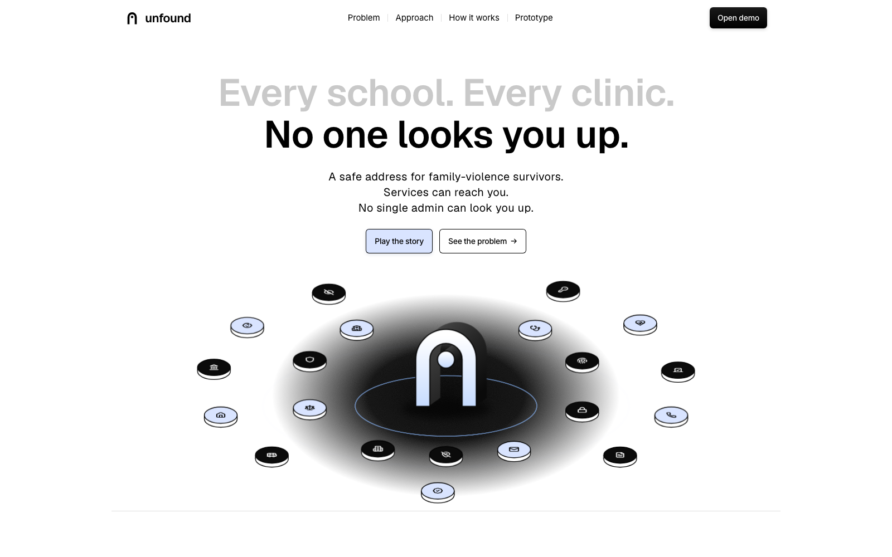
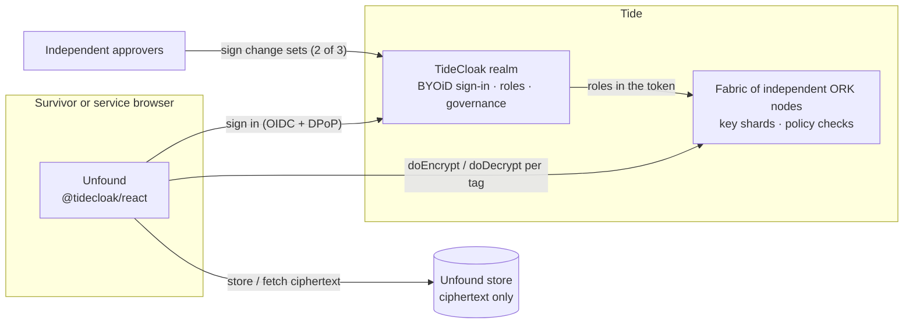

<p align="center">
  
</p>

<h1 align="center">unfound</h1>

<p align="center">
  <b>Be reached, not found.</b><br/>
  A safe-address layer for family-violence survivors.<br/>
  Services can reach them after they move. No employee, admin or operator can find them.
</p>

<p align="center">
  <a href="https://tide.org/tidecloak"></a>
</p>

<p align="center">
  <a href="public/video/unfound.mp4"><b>Watch the film</b></a> ·
  <a href="#quick-start"><b>Quick start</b></a> ·
  <a href="#built-on-tide"><b>Built on Tide</b></a> ·
  <a href="docs/UNFOUND_BRIEF.pdf"><b>Read the brief</b></a>
</p>

---

## Why Unfound

When someone leaves a violent partner, their new address becomes the most dangerous piece of data they own. Then every service they rely on asks for it: their child's school, a new GP, the court, the police. Each one stores it in plain text, where staff and every administrator can read it.

The threat is not a hacker. It is one person with legitimate access, doing one lookup.

| | |
|---|---|
| **1.5 million** | Australian women have experienced violence from a *previous* partner, about nine times more than from a current one [1] |
| **866,700** | of them moved out when it ended. Each move put a new address into school, GP, bank and electoral records [1] |
| **~2 in 3** | women killed by an intimate partner in New South Wales were killed after leaving or while separating [2] |
| **2,215** | allegations of misused confidential information in four years, across seven Queensland agencies [3] |
| **90.4%** | of Vietnamese women abused by a husband never sought formal help, many for fear of being found [4] |

In one documented case, a police officer looked up a survivor's new address and passed it to her abuser [5]. Access controls and audit logs cannot prevent this, because the people who configure them are part of the risk.

## How it works

Unfound seals the address once, on the survivor's own phone, and splits it into three parts. Each service can open only its part. No one, including us, holds a key that opens all three.

| | |
|---|---|
| **Seal once** | The street, the school zone and a contact relay are encrypted separately in the browser. Our servers only ever store ciphertext. |
| **Share the minimum** | Each service holds a role for exactly one part. The school learns "in zone". The GP gets a relay number. |
| **No one alone** | Every grant of access needs two of three independent approvers. An admin who grants themselves access is blocked with `412 QUORUM_NOT_MET`. |
| **Emergencies, with witnesses** | Police request access, two approvers sign, the officer sees the address once, and the access is revoked. |
| **The survivor sees who looked** | Every attempt, approval, refusal and view is recorded in the survivor's own log. |

### Who sees what

| | Today | With Unfound |
|---|---|---|
| School | The full address | "In Footscray North zone ✓" |
| GP clinic | Address and phone | Suburb and a relay number |
| Court mail | The address, sitting in a clerk's file | The street, opened only when the label prints |
| Police | Any record, at any time | One view, after 2 of 3 approvals |
| IT admin, DBA, operator | Everything | Ciphertext. A self-grant stays pending. |
| The survivor | Nothing about who looked | Every access attempt |

We deliberately left out server-side decryption, admin overrides, plaintext logs and any master key.

## Built on Tide

Unfound keeps all authority on Tide. The app never holds a key and never decides access by itself. It asks Tide, and Tide's network answers.



| Tide capability | What Unfound uses it for |
|---|---|
| **TideCloak + BYOiD** | Every person signs in with their own Tide identity. We never store a password. |
| **DPoP** | Tokens are bound to the device that requested them, so a stolen token is useless anywhere else. |
| **Hermetic E2EE** (`doEncrypt` / `doDecrypt`) | The three parts of the address are sealed in the browser, each under its own tag. |
| **Cybersecurity Fabric** | Keys exist only as fragments spread across independent ORK nodes. No node, server or operator ever holds a whole key. |
| **Tag roles** (`_tide_<tag>.selfdecrypt`) | One role for each part. The ORKs check it before they help decrypt, so the network does the refusing, not our UI. |
| **Quorum-Enforced Governance** | Every access change is a change set that a threshold of admins must sign. No one has god-mode. |

### In code

```tsx
// Seal: one item per tag, encrypted in the browser
const sealed = await tc.doEncrypt([
  { data: street,  tags: ["addrfull"] },
  { data: zone,    tags: ["addrzone"] },
  { data: contact, tags: ["addrcontact"] },
]);

// Open: Tide's network checks the caller's role for this tag first
const [inZone] = await tc.doDecrypt([{ encrypted: sealed[1], tags: ["addrzone"] }]);

// Grant: becomes a pending change set, never an instant permission
await tc.AdminAPI.addUserRoles(dan.id, [await tc.AdminAPI.getRole("_tide_addrfull.selfdecrypt")]);
const [cs] = await tc.AdminAPI.getPendingChangeSets();
await tc.AdminAPI.commitChangeSet({ changeSetId: cs.changeSetId, actionType: cs.actionType, changeSetType: cs.changeSetType });
// → 412 QUORUM_NOT_MET until two of three approvers have signed
```

### Roles

| Person | Holds | Can open |
|---|---|---|
| Survivor | `selfencrypt` + `selfdecrypt` on all three tags | Their whole address |
| School | `_tide_addrzone.selfdecrypt` | The zone only |
| GP clinic | `_tide_addrcontact.selfdecrypt` | Suburb and relay |
| Caseworker | `tide-realm-admin`, `selfencrypt` on all tags | Can seal for a client, cannot read |
| IT admin, advocate | `tide-realm-admin` | Nothing. They can only vote. |
| Police | Nothing until a quorum grants it | One view |

### Threat model

| Who tries | What they get |
|---|---|
| A curious or bribed staff member | Only the part their role allows. The attempt is logged for the survivor. |
| An admin granting themselves access | A pending change set and `412 QUORUM_NOT_MET` |
| Whoever runs Unfound's servers | Ciphertext. There is no key to steal or subpoena. |
| A compromised TideCloak server or ORK node | No usable key, because keys only exist as fragments |
| Someone holding a stolen token | Nothing from another device (DPoP) |

## The prototype

<p align="center">
  
  &nbsp;
  
  &nbsp;
  
</p>

Seven people. One address. No master key. Open `/demo?story=1` and the app plays the whole journey by itself. It switches between iPhone, MacBook and iPad, zooms in on each key moment, and presses the real buttons.

| | Who | What happens |
|---|---|---|
| 1 | Linh, survivor | Seals her address. Three ciphertexts, zero plaintext. |
| 2 | Westgate Primary | Confirms the zone. Trying to open the street is **denied** by Tide. |
| 3 | Dan, IT admin | The legacy database shows every address. Unfound shows ciphertext. His self-grant returns **412**. |
| 4–7 | Police, Mai, Ruth | A welfare check is approved 2 of 3. The officer gets one view, then access is revoked. |
| 8 | Linh | "Who looked" shows everything, including Dan's attempt. |

**Measured on the full run:** 68 seconds, 15 Tide operations, 0 plaintext addresses stored, 0 console errors.

## Quick start

Requires Node.js 20+. Docker is only needed for live TideCloak.

```bash
npm install && npm run dev        # http://localhost:3000  ·  /demo  ·  /demo?story=1
```

`/demo` opens on a choice of two modes:

- **Without an account** runs a local mock fabric. It applies the same role and quorum rules, using real AES-GCM in the browser. It shows the experience, not the security guarantees.
- **With a Tide account** runs live on TideCloak. Set it up with one command:

```bash
cp .env.example .env              # licence email, TIDE_TERMS_ACCEPTED=yes (after reading tide.org/legal), local admin password
bash scripts/setup-local.sh
```

The script does the whole setup:
- starts TideCloak in Docker;
- provisions a licensed realm with Quorum-Enforced Governance;
- waits while you enrol your Tide account;
- wires the adapter into the app;
- creates the six `_tide_addr*` roles;
- launches the app.

A realm in Docker serves only your own machine. A public deployment needs hosted TideCloak (Skycloak), and the app code stays the same. Full guide: [`docs/LIVE_TIDECLOAK.md`](docs/LIVE_TIDECLOAK.md).

> **Status.** The live code path is complete, and a licensed realm has been provisioned. Enrolling the first Tide account failed on 22 Oct 2026 because most of Tide's ORK network did not respond ("got 3 of 20 required"). Screenshots: [1](docs/assets/tide-enrol-error-1.png), [2](docs/assets/tide-enrol-error-2.png). Until enrolment succeeds, the public build and the film run on the mock fabric.

**Deploy.** `npm run build` produces `dist/`. On Vercel, import the repo with the Vite preset; `vercel.json` handles routing. On Netlify, `public/_redirects` is included.

**Tide MCP.** [`.mcp.json`](.mcp.json) connects Claude Code to Tide's MCP server. We used `tide_hosting` and `tide_doctor` to plan and check this integration; see [`docs/TIDE_MCP.md`](docs/TIDE_MCP.md).

## Roadmap

| | Milestone |
|---|---|
| **Now** | Live on a hosted Tide realm; confirm cross-user decryption and one-time views with Tide |
| **Next** | Co-design with a family-violence service, a school and a GP clinic; privacy impact assessment and penetration test |
| **Then** | Supervised pilot with 20–30 survivors; Forseti contracts for one-time access; school and GP integrations |
| **Later** | Multi-state rollout in Australia; a Viet Nam pilot under the new Personal Data Protection Law |

The full plan, with stakeholders, feasibility and the path to production, is in the [founder brief](docs/UNFOUND_BRIEF.pdf) ([Markdown](docs/UNFOUND_BRIEF.md)).

## Repository

```
src/landing/       marketing site: hero, problem, approach, who sees what, comparison
src/demo/          the prototype: state engine, fabrics (mock + live), story mode, persona screens
src/demo/live.tsx  TideCloak wiring: provider + DPoP, doEncrypt/doDecrypt, AdminAPI change sets
src/film/          the film as a deterministic, frame-seekable page (/film)
src/motion/        intro, page transitions, smooth scroll, Web Audio sound design
scripts/           setup-local.sh: one-command TideCloak setup
tools/             tide-setup.mjs: adapter and role wiring
docs/              UNFOUND_BRIEF (MD + PDF), DESIGN, TIDE_MCP, LIVE_TIDECLOAK, DEMO_SCRIPT, print/
```

| Document | |
|---|---|
| [Founder brief](docs/UNFOUND_BRIEF.pdf) | Problem, ecosystem, Tide usage, feasibility and roadmap, with 30 cited sources |
| [Design system](docs/DESIGN.md) | Brand, tokens, type, motion |
| [Tide MCP](docs/TIDE_MCP.md) | How Tide's agent tools were used, with `tide_doctor` results |
| [Live TideCloak](docs/LIVE_TIDECLOAK.md) | Manual realm setup |
| [Pocket bookmark](docs/print/unfound-bookmark-print.pdf) | Print-ready 70×210 mm leave-behind ([A4 home print](docs/print/unfound-bookmark-A4.pdf)) |

## References

<sub>Accessed 22–26 October 2026.</sub>

1. ABS. [Personal Safety, Australia 2021–22: Partner violence](https://www.abs.gov.au/statistics/people/crime-and-justice/partner-violence/2021-22).
2. NSW Domestic Violence Death Review Team, 2021–23 report, as reported by the [Canberra Times](https://www.canberratimes.com.au/story/8723440/report-reveals-shocking-trend-for-women-fleeing-domestic-violence/).
3. CCC Queensland. [Operation Impala, Exhibit 95](https://www.ccc.qld.gov.au/sites/default/files/Docs/Public-Hearings/Impala/Exhibits/Operation-Impala-Exhibit-95-Queensland-Police-Service-Complaints-and-Allegations-Data-Analysis.PDF) (2019).
4. UN Viet Nam et al. [National Study on Violence against Women in Viet Nam 2019](https://vietnam.un.org/en/53665-journey-change-second-national-study-violence-against-women-viet-nam-2019-released).
5. [QCAT finds Queensland Police liable after an officer leaked a survivor's address](https://www.sydneycriminallawyers.com.au/?p=41673).
6. OIC Queensland. [Prioritising privacy to keep victims safe](https://www.oic.qld.gov.au/government/compliance-and-audit-reports/prioritising-privacy-to-keep-victims-safe) (2025).
7. Tide. [TideCloak](https://tide.org/tidecloak) · [Core concepts](https://docs.tide.org/Core-Concepts/core-concepts) · [Quorum-Enforced Governance](https://docs.tide.org/Core-Concepts/iga-workflow) · [React SDK](https://docs.tide.org/Languages/React/tidecloak-react-reference).

## Credits

Voice: [Kokoro-82M](https://huggingface.co/hexgrad/Kokoro-82M) (Apache-2.0). Footage and music: [Mixkit](https://mixkit.co). UI sounds: Kenney Interface Sounds (CC0). Illustrations: Notionists by Zoish (CC0) via [DiceBear](https://www.dicebear.com). Icons: [Lucide](https://lucide.dev), [Simple Icons](https://simpleicons.org). Motion: [motion](https://motion.dev), [Lenis](https://lenis.darkroom.engineering).

<sub>All people, addresses and records in this repository are synthetic.</sub>
