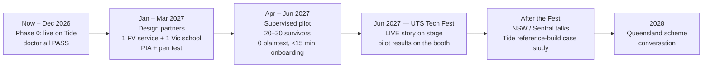

# Unfound — Market & UTS Tech Fest Brainstorm

*Talking doc, 12 Nov 2026 · Team GenData · Companions:* `INFO.md` *(mission brief),* `PROJECT_OVERVIEW.md` *(full project state), repo* `Unfound-Be-reached-Not-found/`*.*

**How to use this file:** work top to bottom in conversation. Each section states a position, the evidence for and against it, and ends with the decision or question it creates. Decisions get written into §8 as we make them.

---

## 0. The one-paragraph version

Unfound lets services reach a survivor without anyone being able to look her up. The survivor is the **user**, never the customer. The market is the institutions legally exposed for holding her address in plain text — schools, family-violence (FV) services, and eventually state governments. The product today is a deployed proof-of-*experience* (mock crypto fabric publicly; since PR #7, 1 Nov 2026, the live Tide path provisions and enrols against a local realm, but sign-in and cross-user decryption are still untested). The next proof must be a supervised pilot. **UTS Tech Fest 2027 (June, Sydney) is our stepping stone: a public deadline that lands mid-pilot, where we show the live system and leave with pilot partners — not just a prize.**

**One line:** *Services can reach them. No one can look them up. Not the staff, not the admin, not the other parent, not even us.*

---

## 1. Who are we targeting?

Three different answers. Keep them separate in every pitch.

| | Who | What they get | What they give |
|---|---|---|---|
| **User** | Survivors, protective parents | Safety: sealed address, choice over who sees what, the "Who looked" log | Nothing. Always free |
| **Operator** | School office staff, GP reception, caseworkers, police | Less work than today's manual flag-and-brief process: one zone check, one relay number | Their existing workflow |
| **Buyer** | Schools (via Compass/Sentral), FV agencies, state governments | Discharged legal duty (FVISS/MARAM), privacy-tort defence, an audit trail | Money, integration, endorsement |

**Rule for all copy and demos:** never pitch the survivor as the market, and never pitch subscription revenue from her. It contradicts "always free" and judges will catch it.

---

## 2. Market segments, ranked

| # | Segment | Role | Need | Evidence of need | Blocker | When |
|---|---|---|---|---|---|---|
| 1 | **Victorian government schools** | Buyer | **High** | FVISS/CISS/MARAM makes schools *prescribed entities* — identifying and sharing FV risk is an existing legal duty, done today with paper flags | Slow procurement, small per-school budgets | Beachhead, 2027 pilot |
| 2 | **Orange Door–aligned FV services** | Referral channel + co-designer | **High** | Onboarding survivors during safety planning is already their job; MARAM obligations | Grant-dependent funding | Beachhead, with #1 |
| 3 | **NSW schools via Sentral** | Scale buyer | High | Largest protection-order population in the country (100,000+ orders in force in NSW) | Sentral is a channel gatekeeper, not a customer | Expansion, 2027–28 |
| 4 | **FDR practitioners, Independent Children's Lawyers, Legal Aid** | Referral rail (custody track) | Medium | s60I makes FDR the mandatory first step for separating parents; ~97% never reach a courtroom | Fragmented practices, no IT budget | 2027–28, validation needed |
| 5 | **GPs and health services** | User first, buyer later | Medium | Address + phone sit in clinical records | Clinical-system integration is hard | Post-pilot |
| 6 | **Police and courts** | Approver persona now, buyer last | High pain | Qld leak cases are their own scandal | Security accreditation (IRAP-class) takes years | Demo persona only, for now |
| 7 | **State government (Queensland first)** | The scheme sale | Biggest prize | Documented scandals, political appetite, Police Protection Directions live 1 Jan 2026 | This is a policy sale, not a product sale | 2028+ |

### 2.1 The beachhead logic (Victoria first)

- The duty is **legislated** (FVISS/MARAM). We sell infrastructure for an obligation schools already carry, not new behaviour.
- Compass (dominant parent portal in Victorian government schools, 5,000+ schools nationally) means one integration pattern covers the state.
- NSW follows through Sentral (~two-thirds of NSW public schools per the ACCC's May 2024 statement of issues). Two integrations cover the two largest states.

### 2.2 The honest size check

- ~9,653 Australian schools × A$49/school/month ≈ **A$5.7M/year if every school in the country paid**.
- Conclusion to say out loud before someone else does the maths: **schools are the wedge, not the business.** The business is agencies plus a state substitute-address scheme.
- Framing: the A$925.2M Leaving Violence Program and the A$3.4B National Plan are the funding rails for the free tier, delivered through partner-held grants.

### 2.3 Segment to demote: custody subscriptions

The brief proposes protective parents paying ~A$10–20/month. Problems: it collides with "survivors always free", fee waivers are the norm in this category, and court/mediator steering is unproven. **Recommendation: demote to "validate later"** — keep the custody *use case* (it's emotionally powerful and the demo's Geelong track), drop it as a stated revenue line until an FDR partner validates willingness to pay.

---

## 3. Justification — why now, why us

### 3.1 The problem in one breath

A family hiding from a dangerous person is betrayed not by hackers but by paperwork. Every service they must still use holds their address in plain text, and court orders restricting access are enforced by manual flags and staff memory. **She can change her phone, her job, her friendships. She cannot change how a school files a letter.**

Key numbers (from `INFO.md` / `docs/UNFOUND_BRIEF.md`):

| Figure | Point |
|---|---|
| 100,000+ protection orders in force, NSW | Demand is current, not hypothetical |
| 12,000+ intervention orders, Victoria, Nov 2024–Mar 2025 (2.7× surge) | Demand is accelerating |
| 142,719 FVIO applications (Vic, 2020–24) involving children ≤17 | Children are the records back-door |
| 2,215 misuse allegations, 7 Qld agencies, 4 years (Operation Impala) | The insider is the documented threat |
| ~39 US states have Address Confidentiality Programs; Australia has none | The gap is structural, not a niche |

### 3.2 Four deadlines doing our marketing (next 12 months)

| When | What | What it creates |
|---|---|---|
| 10 Jun 2025 (live) | Statutory privacy tort | Agencies can be sued for exactly this failure |
| 1 Jan 2026 (live) | Qld on-the-spot 12-month Police Protection Directions | A family needing record protection *that afternoon* |
| 1 Jul 2025 (flowing) | Leaving Violence Program, A$925.2M / 5 years | Money that can fund the free tier |
| 10 Dec 2026 (due) | Children's Online Privacy Code registered | Children's records become a compliance deadline |

**The market isn't waiting to be created — it's waiting to be served.**

### 3.3 The three analogies (use these with non-technical audiences)

1. **The silent elector, for everything.** The AEC already accepts that safety justifies hiding an address. Unfound extends that accepted principle to every service in her life.
2. **A PO Box for records.** The school doesn't need her street; it needs to reach her.
3. **The footy club account.** Every records-access change needs two signatories — not the principal alone, not the IT admin, not us.

### 3.4 What legitimises us

- We implement an **existing legislated duty** (FVISS/CISS/MARAM) instead of asking for new behaviour.
- The failure record is documented by **Australian regulators** (Qld 2014 liability finding, Qld 2024 auto-fill, Operation Impala), not by us.
- We're a **reference build on Tide** — an exchange (their developer-GTM needs proof), not a favour.

### 3.5 Where the justification is weak (fix before a judge finds it)

- [ ] **No demand evidence yet:** no LOI, no pilot partner, no recorded survivor/caseworker interviews. Everything above proves the *problem*, not that institutions will adopt *us*.
- [ ] The headline 40% agency-disclosure figure is **UK data**. Australian numbers (Impala, order volumes) carry the local argument; lead with those.
- [ ] "Schools will pay A$49/month" is a hypothesis. Unvalidated.
- [ ] Custody willingness-to-pay is unvalidated (see §2.3).

---

## 4. Where the product is right now

Say this honestly, always: **proof-of-experience, not a pilot-ready product.**

| Layer | State |
|---|---|
| Landing page, 8-scene story demo (`/demo?story=1`), film | ✅ Real, deployed |
| Mock fabric (AES-GCM, role + quorum rules) | ✅ Real crypto, simulated network |
| Live TideCloak code path (DPoP, `doEncrypt`/`doDecrypt`, change sets) | ⚠️ **Partly proven (PR #7, merged 1 Nov 2026):** against a *local* realm, provisioning, Tide enrolment, adapter export, 6 roles, 7 persona users and QEA-approved role grants all succeed. Encrypt/decrypt bugs found on first contact were fixed. **Not yet run:** persona sign-in and a sealed address opened end to end |
| Cross-user decryption (survivor seals → school opens) | ❌ **Still untested — still the existential risk.** Now the very next test, no longer blocked by enrolment |
| "Who looked" log, one-time police view | ⚠️ Real UI, mock-fed; one-time view is app-level only |
| Hosted realm | ❌ Not yet (Phase 0 ask to Tide). The 22 Oct enrolment failure ("got 3 of 20 required") did not recur on the local realm |
| Backend store, integrations, pen test, PIA, WCAG, automated tests | ❌ Do not exist |

**The sentence to memorise (updated after PR #7):** *"The public demo runs the mock fabric: real AES-GCM in the browser, same role and quorum rules, so it shows the experience, not the security guarantees. On our local Tide realm, enrolment, roles and quorum-approved grants now work; the last step, a survivor sealing and a school opening, is what we're testing next."*

**Don't update public copy yet:** the README and the demo's welcome screen still say enrolment failed, deliberately, until the cross-user test passes (PR #7 note). Same rule for pitches: say "working on a local realm", never "live", until that test is filmed.

**Why cross-user decryption matters most:** if a service holding `_tide_addrzone.selfdecrypt` cannot open what the survivor sealed, the product becomes per-service re-sealing by her client — a different architecture and a worse experience. Tide's written answer to technical question #1 (`PROJECT_OVERVIEW.md` §7.3) gates the design. **Get it in writing.**

---

## 5. What needs upgrading

### P0 — before we may say the word "live"

- [x] ~~Enrolment succeeds~~ — done on a local realm (PR #7, 1 Nov 2026)
- [ ] **Next test:** sign in as `linh`, seal; sign in as `school`, open zone (expect OK) and full address (expect DENIED). Film it
- [ ] Hosted TideCloak realm (Skycloak, AU) + `tide_doctor` all PASS (the adapter now exports locally, so re-run the doctor)
- [ ] Written answer: cross-user decryption (or fallback chosen: per-service re-sealing / Forseti policy)
- [ ] Full 8-scene story replayed on live Tide; filmed as the backup demo
- [ ] Named Tide contact + dated checkpoint (meeting asks, `PROJECT_OVERVIEW.md` §7)

### P1 — pilot-grade (before any real family touches it)

- [ ] Postgres ciphertext store (today: browser localStorage only)
- [ ] "Who looked" log fed by real change-set history, not mock events (Tide question #4)
- [ ] Approvers from ≥2 independent organisations (Tide question #3)
- [ ] Break-glass: one view, then revoked, enforced as strongly as the platform allows (Forseti, Tide question #2)
- [ ] Safety UX: quick exit, disguised app name, coercion-aware flows, EN/VI copy
- [ ] WCAG 2.2 AA; trauma-informed usability sessions with caseworkers
- [ ] PIA, independent pen test, threat model, data-sharing agreements, incident response
- [ ] Manual onboarding path first (no portal integration needed for pilot)

### P2 — after pilot proof

- [ ] Compass connector, then Sentral connector
- [ ] Court print relay (street opens only as the label prints)
- [ ] Billing, multi-tenant admin, agency reporting
- [ ] Queensland scheme proposal; Vietnam pilot (PDPL, from 1 Jan 2026)

**Framing that helps with Tide and judges:** every hard blocker is Tide-side; everything else is ordinary application engineering.

---

## 6. UTS Tech Fest 2027 as the stepping stone

### 6.1 What it is

Sydney's annual student-driven tech showcase, held each June on the UTS campus (Faculty of Engineering and IT), with industry partners and judges. Next edition: **~June 2027**.

### 6.2 ⚠️ Eligibility — resolve first

Tech Fest is UTS's own student showcase and **we are an RMIT team**. Before building the plan around it:

- [ ] Confirm 2027 entry rules: UTS-enrolled students only, or open/partner categories?
- [ ] If closed: recruit a UTS collaborator, enter via an industry/community partner, or use it as a networking floor instead of a competition entry.

### 6.3 Why it's the right stone anyway

- **Timing:** June 2027 lands *mid-pilot* (pilot runs Apr–Sep 2027). Most student projects show a prototype; we'd show a live system with a named pilot partner.
- **Audience:** Sydney industry + NSW public-sector presence matches our *scale* market (NSW/Sentral), while pilot proof comes from Victoria. Pilot proof from Vic, scale story for NSW reads as ambition, not drift.
- **Function:** it's a forcing deadline, a credibility artefact, and a partner-recruitment floor in one. The prize is a bonus.

### 6.4 Path to the Fest

### 6.5 What we show (three artefacts, in priority order)

1. **The live story.** The 8-scene, ~70-second story running on real Tide — not the mock fabric. Film of a live run as backup.
2. **The denial, live.** A judge holds the school persona, tries to open the full address, gets **DENIED**, then watches a lone admin commit fail with `412 QUORUM_NOT_MET`. This is the whole product in 30 seconds.
3. **A named pilot partner.** Logo, LOI, or a quote from the FV service / school on the booth. This separates us from every other prototype in the hall.

### 6.6 What success looks like (pick in §8)

| Metric | Why |
|---|---|
| 2+ pilot-partner introductions (school network, agency, portal vendor) | The pilot is the product's next proof |
| Tide reference-build / case-study commitment | Distribution and credibility we can't buy |
| UTS collaborator recruited (if eligibility requires) | Unlocks entry itself |
| Prize / category award | Nice. Not the strategy |

Also capture at the Fest: judge feedback verbatim, industry contacts (NSW education, health, cyber), and photos/video for the Tide case study and the next funding conversation.

### 6.7 Risks to the Fest plan

| Risk | Mitigation |
|---|---|
| Not eligible as an RMIT team | Resolve §6.2 *now*, not in May |
| Cross-user decryption fails, or the hosted realm doesn't land → demo is still mock | Run the cross-user test *this month*; if it fails, choose the fallback (per-service re-sealing) before Phase 1. Honesty table on the booth; never claim live |
| Pilot partner not signed by June | Show the co-design agreement / LOI instead; name the pipeline honestly |
| Live demo fails on venue network | Filmed live-run backup + mock mode one keystroke away (`?mode=mock`) |
| Safety/ethics questions from judges | Scope boundary ready: what we cover, what we don't (physical stalking, coerced device, non-participating services) |

---

## 7. Narrative by audience (same facts, different door)

| Audience | Lead with | Proof they want | Never say |
|---|---|---|---|
| School principal / office manager | "Less work than the paper flag you run today" | Zone check in one click; the ADVO's rules *are* the roles | Crypto terms |
| FV service / Orange Door | "MARAM with a system instead of a spreadsheet" | Caseworker onboarding flow; survivor's log | That survivors self-serve alone |
| Government / scheme buyer | "The substitute-address scheme Australia never built" | Regulator-documented failure record; pilot numbers | Startup growth talk |
| Tide | "A reference build for the insider-threat story" | Doctor results, 4-day build via their MCP, change-set log as a new primitive use | "Fork of Keycloak", "blockchain" |
| Tech Fest judge | "Watch the denial happen" | Live quorum failure (412), then quorum met | "Unbreakable", "military-grade", "AI-powered" |
| Survivor advocate | "She sees every attempt, including the refused ones" | Scope boundary, stated plainly | That we prevent physical stalking or coercion |

---

## 8. Decisions to make (fill in as we talk)

- [ ] **D1 — Beachhead:** Victoria (schools + Orange Door) first, NSW as the scale story? *Recommendation: yes.*
- [ ] **D2 — Tech Fest eligibility:** any UTS-enrolled member, or recruit/partner? *Blocks the whole timeline — resolve first.*
- [ ] **D3 — Custody subscriptions:** keep as a revenue line, or demote to "validate later"? *Recommendation: demote (§2.3).*
- [ ] **D4 — Fest success metric:** pilot partners, Tide case study, collaborator, or prize? *Recommendation: partners + case study.*
- [ ] **D5 — First integration bet:** Compass before Sentral? *Follows D1.*
- [ ] **D6 — What we stop doing:** e.g. no new landing-page features until Phase 0 is live. *Decide explicitly.*

## 9. Open questions for the room

1. Who is our first named human at a Victorian FV service or school — and who makes that introduction (Tide ask #4)?
2. If cross-user decryption comes back "no", do we accept per-service re-sealing, or does that change the pilot service (school zone only)?
3. What does a school actually pay with — which budget line, whose signature? (Interview question, not an assumption.)
4. Which Tech Fest category fits: social impact, cybersecurity, or software engineering? The pitch differs by category.
5. What can we ethically measure in the pilot? (Disclosure events, onboarding time, attempts visible — not "harm prevented".)
6. By what date do we abandon the Tech Fest entry if eligibility or Phase 0 fails, and what's the fallback stage (Tide case study launch, sector conference)?

## 10. Evidence still to collect

- [ ] 5–10 interviews: school office managers, caseworkers, one FDR practitioner
- [ ] One LOI (any partner type)
- [ ] Tide's written answers to the four technical questions
- [ ] Tech Fest 2027 entry rules
- [ ] Pilot success criteria signed off by the partner service (exit criteria in `PROJECT_OVERVIEW.md` §8 are our draft, not theirs)
