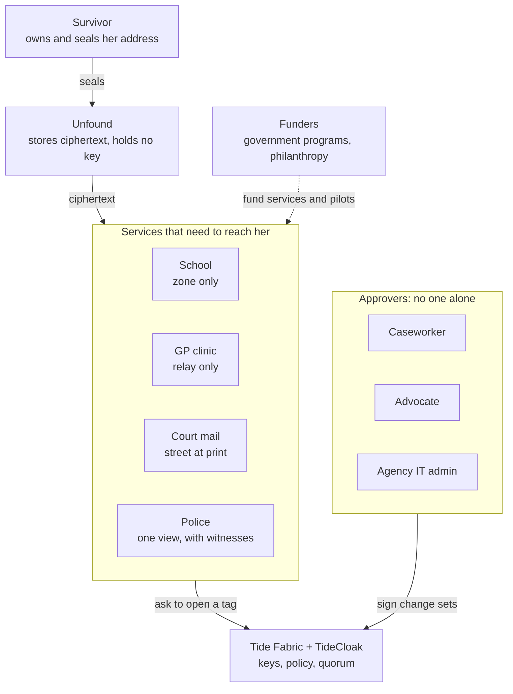
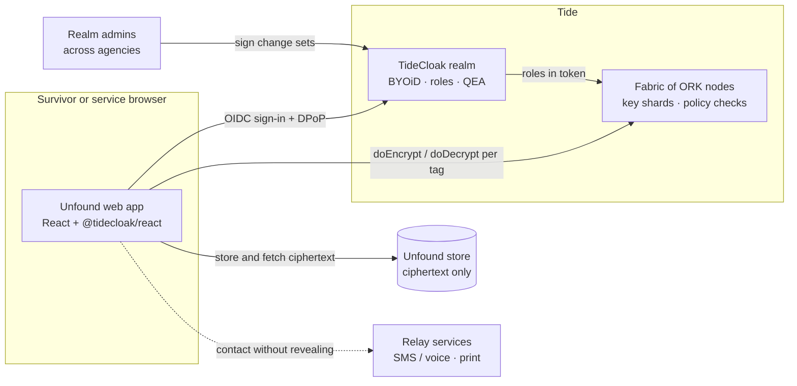

# Unfound: founder brief

**Be reached, not found.**
A safe-address layer for family-violence survivors, built on Tide.

Prepared for: Tide · Version 1.0 · 26 October 2026
Repository: https://github.com/BennedictQuanTon/RMIT_SGS_GenData_C2
Film: `public/video/unfound.mp4` (1:55)

---

## Contents

1. Executive summary
2. What Unfound is
3. Brand
4. The problem
5. Stakeholders and ecosystem
6. The solution
7. How Unfound uses Tide
8. Technical architecture
9. What exists today
10. Landscape and alternatives
11. Feasibility
12. Path to production
13. Roadmap
14. Business model
15. Risks and mitigations
16. What we are asking Tide for
17. References

---

## 1. Executive summary

**The problem.** When a survivor of family violence leaves, her new address becomes the most dangerous piece of data she owns. Every service she then needs (her child's school, a new GP, the court, the police) stores that address in plain text, readable by staff and by every administrator. The threat is not a hacker. It is one insider with legitimate access doing one lookup. In New South Wales, about two in three women killed by an intimate partner were killed after leaving or while separating [5]. In Queensland, 2,215 allegations of misused confidential information were recorded across seven agencies in four years [7], and a police officer passed a survivor's new address to her abuser [9].

**The product.** Unfound seals the address once, on the survivor's phone, in three parts: the full street, the school zone and a contact relay. Each service can open only the part it needs. Opening the full address, even in an emergency, takes two of three independent approvers, for one view, and the survivor sees every attempt in her own "Who looked" log.

**Why Tide.** The promise only holds if no one, including the people who run Unfound, holds a key or can grant themselves access. That is Tide's core design. TideCloak encrypts in the browser with keys that exist only as shards across Tide's Fabric. ORK nodes check a role per data tag before they help decrypt. Every access change is a Quorum-Enforced Governance change set signed by a threshold of admins [20][21][22].

**What exists.** A working prototype with seven personas on three devices, and a 68-second auto-played story running 15 Tide operations with 0 plaintext addresses stored. It also has a live TideCloak code path (DPoP, `doEncrypt`/`doDecrypt`, AdminAPI change sets), a one-command local setup, a film and a cited research base. It was built in four days for RMIT Hackathon 2026, Challenge 2 "UNLOCKED".

**The ask.** Help to move from prototype to a supervised pilot:

- a hosted TideCloak realm;
- answers to four specific integration questions (section 16);
- access to the Launch Program;
- an introduction to one family-violence service willing to pilot.

---

## 2. What Unfound is

| | |
|---|---|
| **One line** | A safe-address layer: services can reach a survivor after she moves, and no single employee, admin or operator can find her. |
| **For whom** | Primary: people who have left a violent partner and moved. Secondary: the services that must contact them. |
| **Category** | Privacy infrastructure for public and community services (B2G / B2B), free for survivors. |
| **Core idea** | One address, three sealed parts, one role per part, no master key, no admin override. |
| **Built on** | TideCloak (Keycloak-compatible IAM with BYOiD sign-in), Tide's Cybersecurity Fabric, Hermetic E2EE, Quorum-Enforced Governance. |
| **Stage** | Prototype (October 2026). The live Tide path is wired; the public demo runs on a mock fabric that applies the same rules. |

### What changes for each person

| Who | Today they see | With Unfound they see |
|---|---|---|
| School | Full address | "In Footscray North zone ✓" |
| GP clinic | Address and phone | Suburb and a relay number |
| Court mail | Address in the clerk's file | The street, opened only as the label prints |
| Police | Any record, any time | Break-glass: 2 of 3 approvals, one view, then revoked |
| IT admin, DBA, operator | Everything | Ciphertext. A self-grant stays pending. |
| The survivor | Nothing about who looked | Every attempt, approval, refusal and view |

---

## 3. Brand

| Item | Value |
|---|---|
| Name | **Unfound**, written as the lowercase wordmark `unfound`. Two syllables; says what the product protects. |
| Slogan | **Be reached, not found.** |
| Support line | Your address, held by no one. |
| Hero line | Every school. Every clinic. No one finds you. |
| Mark | "The pin with no point": a map-pin head drawn as an open arch with a dot inside. The point that would land on a location is missing. Read twice, it is also a doorway. |
| Palette | Obsidian `#000000`, Canvas `#ffffff`, Fog `#f9fafb`, Slate Mist `#e5e7eb`, Stone `#c9c9c9`, Graphite `#6e6e6e`; Lam Wash `#e2eeff` for sealed surfaces, Lam Seal `#8dbbff` for the number to remember, Lam `#3d8bff` for the one call to action. |
| Type | Geist (display, weight 600), Inter (UI), system monospace for ciphertext. |
| Voice | Short, calm, factual. Say "survivor". Never show violence. Name what people can now do, not the security mechanism. |
| Status language | Form and words, not red and green: **SEALED**, **DENIED**, **PENDING**, **APPROVED**. |

The full design system is in `docs/DESIGN.md`.

---

## 4. The problem

### 4.1 Leaving is when the risk peaks

| Figure | What it means | Source |
|---|---|---|
| **27%** | of ever-partnered women aged 15–49 worldwide have experienced physical or sexual intimate-partner violence | WHO, 2021 [1] |
| **51,100 · 140 a day** | women and girls killed by a partner or family member worldwide in 2023 | UN Women and UNODC, 2024 [2] |
| **1.5 million** | Australian women have experienced violence from a *previous* cohabiting partner (16%), about nine times the 173,300 who experienced it from a current one | ABS PSS 2021–22 [3] |
| **64% · 866,700** | of those women moved out when the relationship ended: each move is a new address in school, GP, bank and electoral records | ABS PSS 2021–22 [3] |
| **~2 in 3** | women killed by a male intimate partner in NSW were killed after leaving or while separating | NSW DVDRT 2021–23 [5] |
| **34 · +28%** | women killed by an intimate partner in Australia in 2022–23, up 28% in a year | AIC, via LSJ [6] |
| **A$22 billion** | estimated cost of violence against women and their children in Australia in 2015–16 | KPMG for DSS, 2016 [4] |
| **90.4%** | of Vietnamese women abused physically or sexually by a husband never sought formal help; fear of stigma and further harassment was a main reason | National Study on VAW in Viet Nam 2019 [12] |

### 4.2 The threat is the insider

| Figure | What it means | Source |
|---|---|---|
| **2,215** | allegations of misused confidential information in four years across seven Queensland agencies | CCC Queensland, 2019 [7] |
| **4.8×** | growth of those allegations outside the police (health, education, corrections, transport): 65 → 312 a year | CCC Queensland, 2019 [7] |
| **87%** | of police allegations (1,391 of 1,591) were unauthorised access or unauthorised disclosure | CCC Queensland, 2019 [7] |
| **2014** | a Queensland officer searched the police database and passed a survivor's new address to her abuser; the tribunal found the police service liable | QCAT, reported [9] |
| **"since at least 2017"** | Queensland police knew their system auto-filled victims' addresses into documents served on offenders | Qld Information Commissioner, Dec 2025 [10] |
| **US$17.4 million** | average annual cost of insider risk per organisation; 81 days to contain an incident | Ponemon / DTEX, 2025 [17] |
| **1,205** | data-breach notifications to the OAIC in 2025, an all-time high; health providers were the most affected sector (19%) | OAIC, 2026 [16] |

### 4.3 Technology already serves the abuser

| Figure | What it means | Source |
|---|---|---|
| **99.3%** | of family-violence practitioners surveyed had clients who experienced technology-facilitated stalking and abuse | WESNET, 2020 [13] |
| **~1 in 3 · +245%** | victim-survivors tracked by GPS, up 245% on the 2015 survey | WESNET via Safe and Equal [13][14] |

### 4.4 Why this stays unsolved

- **Permissions do not fix it.** Role-based access and audit logs are configured and overridden by administrators, the very people in the threat model. Logs show harm only after it has happened.
- **Address programs are narrow.** Australia's silent-elector scheme covers the electoral roll only [24]. In the US, about 39 state Address Confidentiality Programs substitute a mailing address [25][26], but they rely on manual forwarding and on agencies agreeing to accept the substitute. California's program alone had 6,212 active participants in 2023, and more than half were school-aged children [27].
- **Encryption at rest does not fix it.** The provider holds the key, so the operator, and anyone who compromises the operator, can read everything [23].
- **Regulation is tightening.** Australia's statutory tort for serious invasions of privacy commenced on 10 June 2025 [18]. Viet Nam's Personal Data Protection Law (No. 91/2025/QH15) took effect on 1 January 2026, with fines up to 5% of annual revenue for some violations [19]. Agencies now need to *prove* that staff cannot misuse data.

---

## 5. Stakeholders and ecosystem

| Stakeholder | What they need | What they do in Unfound | What they can never do |
|---|---|---|---|
| **Survivor** | To use services without creating a new way to be found | Seals her address, chooses services, reads "Who looked" | Lose control of who holds which part |
| **Caseworker** (family-violence service) | To onboard a client fast and safely | Seals on the client's behalf, votes on access requests | Read the address |
| **School** | Enrolment within catchment, a way to contact the parent | Confirms "in zone"; contacts through the relay | See the street |
| **GP clinic** | Recall, referrals, a way to contact the patient | Uses suburb and relay number | See the street |
| **Court registry** | To serve and post documents | Opens the street only as the label prints | Put the address in a file the other party can read |
| **Police** | Welfare checks, protection-order service | Requests break-glass; opens once after 2 of 3 approvals | Browse addresses at will |
| **Independent approvers** (advocate, second agency) | Assurance that emergency access is real and necessary | Approve or deny change sets | Approve alone |
| **Agency IT admin** | To run systems and pass audits | Operates the realm; one vote among several | Grant themselves access |
| **Unfound (operator)** | To run the service without becoming a risk | Stores ciphertext, routes requests | Decrypt anything |
| **Tide** | Real-world, high-stakes use of the Fabric | Holds key shards, enforces policy and quorum | Learn what data it protects |
| **Funders and regulators** | Evidence of safer outcomes and compliance | Fund pilots; receive aggregate, non-identifying metrics | See individual records |

---

## 6. The solution

### 6.1 Five moves

| | What happens | Tide primitive |
|---|---|---|
| **01 · Seal once** | The address is split into `addrfull` (street, unit, postcode), `addrzone` (catchment) and `addrcontact` (suburb, relay number), and each part is encrypted in the survivor's browser. | `doEncrypt` with tags; Hermetic E2EE |
| **02 · Share the minimum** | Each service holds a role for exactly one tag. | `_tide_<tag>.selfdecrypt`, checked by ORKs |
| **03 · No one alone** | Any role grant is a change set; two of three realm admins must sign it. A lone commit returns `412 QUORUM_NOT_MET`. | Quorum-Enforced Governance, threshold signatures |
| **04 · Emergencies, with witnesses** | Police request break-glass; two approvers sign; one view; the role is revoked. | Signed change sets |
| **05 · Survivor sees who looked** | Every attempt, approval, refusal and view appears in her own log. | Change-set history, Fabric results |

### 6.2 The story the prototype plays (`/demo?story=1`)

| Scene | Person · device | What happens |
|---|---|---|
| 1 | Linh · iPhone | Seals her new address: three ciphertexts, zero plaintext. |
| 2 | Westgate Primary · MacBook | Confirms "Footscray North zone ✓". Trying to open the street: **DENIED** by the network. |
| 3 | Dan, IT admin · MacBook | The legacy database shows every address; Unfound shows ciphertext. His self-grant becomes a change set; committing it returns **412**. |
| 4 | Const. Reyes · iPad | Requests a welfare check: change set **PENDING (0/2)**. |
| 5–6 | Mai and Ruth, approvers | Deny Dan's request; approve Reyes's: quorum met. |
| 7 | Const. Reyes · iPad | Opens the address once; the role is revoked automatically. |
| 8 | Linh · iPhone | "Who looked": every event, including Dan's attempt. |

What we chose **not** to build: server-side decryption, an admin override, plaintext logs, a master key.

---

## 7. How Unfound uses Tide

| Tide component | What it is | What Unfound uses it for | Why it matters here |
|---|---|---|---|
| **TideCloak** | Keycloak-compatible IAM secured by Tide's Fabric [20] | Realm, users, roles, OIDC sign-in for every persona | Standard integration for agencies already on OIDC |
| **BYOiD** | Users bring a Tide identity they control [20] | Survivors and staff sign in without Unfound storing passwords | No credential database to leak |
| **DPoP** | Sender-constrained tokens (`useDPoP`, relay page `tide_dpop_auth.html`) | Tokens bound to the browser that requested them | A stolen token does not work on another machine |
| **Cybersecurity Fabric / ORKs** | Decentralised nodes holding key fragments; "no single node holds a complete key. Ever." [21] | Holds the keys for every address tag | Nobody at Unfound, the agency or Tide can decrypt alone |
| **Threshold** | A minimum number of ORKs must take part, typically 14 of 20 [21] | Every encrypt and decrypt | Compromising one node or one server is not enough |
| **Hermetic E2EE: `doEncrypt` / `doDecrypt`** | Encryption in the user's browser with tagged data [21] | Seals the three address parts; opens one part per service | Our server holds ciphertext only |
| **Tag roles: `_tide_<tag>.selfencrypt` / `.selfdecrypt`** | Realm roles checked before decryption | One role per tag per service: zone for schools, contact for GPs, full only by quorum | Least privilege is enforced by the network, not by our UI |
| **Quorum-Enforced Governance (QEA)** | Admin changes are proposed, reviewed and approved by several admins, signed with threshold signatures, all logged [21][22] | Every role grant, including break-glass; `AdminAPI.addUserRoles`, `getPendingChangeSets`, `commitChangeSet` | Ends "god-mode": an admin cannot grant themselves access |
| **Change-set history** | Every proposal, vote and outcome is recorded [21] | Feeds the survivor's "Who looked" log | Turns audit into something the survivor can see |
| **Forseti contracts** (planned) | Custom policy validated by the ORKs [21] | One-time views and time-boxed break-glass enforced by the network | Moves "open once" from app logic into the Fabric |
| **Tide MCP** | Tide's agent tools (`tide_hosting`, `tide_doctor`) | Chose local vs hosted realms and checked the integration; declared in `.mcp.json` | Repeatable, checkable setup for the next developer |

### Code map

| File | Tide feature |
|---|---|
| `src/demo/live.tsx` | `TideCloakContextProvider` with DPoP, sign-in, `doEncrypt` / `doDecrypt`, AdminAPI change sets |
| `src/demo/engine.ts` | Tags, `_tide_<tag>.*` roles, quorum threshold `max(1, floor(0.7 × N))` |
| `src/demo/fabric.ts` | The `Fabric` interface implemented by live and mock modes |
| `tools/tide-setup.mjs` | Copies the realm adapter, creates and assigns the six `_tide_addr*` roles |
| `scripts/setup-local.sh` | TideCloak in Docker, licensed realm with QEA, enrolment, wiring, app start |
| `docs/TIDE_MCP.md` | How Tide's MCP was used, with `tide_doctor` results |

---

## 8. Technical architecture

### 8.1 Stack today

| Layer | Choice |
|---|---|
| Front end | Vite 5, React 18, TypeScript 5.6, react-router 6, motion 12, Lenis |
| Identity and crypto | `@tidecloak/react` 0.14.33, DPoP ES256 |
| Local realm | `tideorg/tidecloak-dev` in Docker, Tide realm kit, QEA on |
| Mock fabric | WebCrypto AES-GCM 256 with the same role and quorum rules, so the app runs without a realm |
| Hosting | Static build (Vercel or Netlify) |

### 8.2 Data model

| Object | Contents | Stored where |
|---|---|---|
| Sealed record | Three ciphertexts, each with a tag | Unfound store |
| Service binding | Which service holds which tag role | TideCloak roles |
| Change set | Requested role, target, reason, votes, status | TideCloak QEA |
| Event | Who did what to which record, and the result | Change-set history plus the Unfound event log (no plaintext) |

### 8.3 Threat model

| Adversary | Outcome |
|---|---|
| Curious or bribed staff member at a service | Gets only the tag their role allows; the attempt is logged for the survivor. |
| Realm admin granting themselves access | A pending change set; committing alone returns `412 QUORUM_NOT_MET`. |
| Unfound operator or a database breach | Ciphertext only; no key on the server to steal or subpoena. |
| Compromised TideCloak server or one ORK | No usable key: keys exist only as fragments across independent nodes. |
| Stolen access token | Useless from another device (DPoP). |
| Abuser coercing the survivor's own device | Out of scope for cryptography. Mitigations: quick exit, no address shown by default, caseworker-assisted recovery (roadmap). |

---

## 9. What exists today

### 9.1 Prototype metrics

| Metric | Value |
|---|---|
| Build time | 4 days (22–25 October 2026), 21 commits |
| Source | 36 TypeScript/TSX files, 4,721 lines, plus 679 lines of CSS |
| Personas and screens | 7 personas (survivor, school, GP, IT admin, two approvers, police), 5 role screens |
| Devices simulated | iPhone, MacBook, iPad |
| Auto-played story | 8 scenes, 68 s, 15 Tide operations, **0 plaintext addresses stored** |
| Data tags and roles | 3 tags, 6 `_tide_addr*` roles, quorum 2 of 3 |
| Bundle (gzip) | 260 KB landing, 67 KB demo chunk, 3 KB DPoP helper |
| Film | 1:55, 1080p, 27 MB, voice by Kokoro, rendered frame by frame from the real prototype |
| Research base | 15 cited sources in the README, 30 in this brief |
| Tide checks (`tide_doctor`) | DPoP client **PASS**, DPoP relay page **PASS**, secrets hygiene **PASS**; adapter waiting on an enrolled realm |
| Console errors in end-to-end runs | 0 |

### 9.2 Live Tide status, stated plainly

The realm `unfound1` was provisioned and licensed on local TideCloak with QEA on. Creating the first Tide account then failed on every attempt on 22 October 2026, inside Tide's enclave: "Could not reach enough NEW ORKs (got 3 of 20 required)" and "(got 7 of 20 required)". Earlier licence attempts had returned "Midgard.FinalizeWallet: Not enough orks returned an ok response". The live path switches on as soon as `public/tidecloak.json` holds an enrolled realm. Screenshots are in `docs/assets/`.

---

## 10. Landscape and alternatives

| | Survivor chooses what each service sees | Insiders and admins cannot read it | No single person can grant access | Emergency access with witnesses | Survivor sees who looked | Works across services |
|---|:-:|:-:|:-:|:-:|:-:|:-:|
| Silent elector (AU) [24] | – | ◐ | – | – | – | – |
| Address Confidentiality Programs (US) [25][26] | ◐ | ◐ | – | ◐ | – | ◐ |
| Role-based access + audit logs [7][8] | – | – | – | ◐ | – | – |
| Encryption at rest, provider-held key [23] | – | – | – | – | – | ◐ |
| **Unfound on Tide** [20][21][22] | **●** | **●** | **●** | **●** | **●** | **●** |

● yes · ◐ partly · – no. Our assessment, from the public descriptions cited.

Our edge is not an encryption library. It is the combination of three things. Least-privilege disclosure per service, enforced outside our control. Governance where no single person, including us, can grant access. And a survivor-facing record of every attempt. Tide is what makes all three possible together.

---

## 11. Feasibility

**Technically feasible now.**

- Tide supplies the hard parts: threshold key management, policy enforcement at the ORKs, quorum governance and DPoP.
- What remains is ordinary application engineering: a ciphertext store, relay integrations and onboarding.
- The live path is already written against `@tidecloak/react`, and only enrolment was blocked.
- TideCloak's free tier covers 100 users [28], enough for a first pilot of about 30 survivors, 10 service staff and 3 approvers.

**Operationally feasible.**

- Services keep their own systems. They hold a role, open one tag and use a relay.
- Schools and clinics need no new hardware.
- Onboarding goes through caseworkers, who already do safety planning.

**Fundable.**

- Australia's Leaving Violence Program is funded at A$925.2 million over five years [29], within more than A$3.4 billion committed to the National Plan [29]. That is a pathway for funded delivery partners.
- Privacy reform [18][19] gives agencies a compliance reason to adopt.

**Market sized from one segment.**

- There are 9,653 schools in Australia [30].
- At a hypothetical A$49 per school per month, schools alone are about A$5.7 million a year.
- Clinics, courts and police are additional.
- The price is a hypothesis to test in the pilot.

**Proven pattern.** US Address Confidentiality Programs show sustained demand, with California's growing about 12% a year [27]. They also show the gap: manual mail forwarding, no cryptographic control, and nothing for the survivor to see.

---

## 12. Path to production

| Area | Prototype today | Production requirement |
|---|---|---|
| Realm | Local Docker | Hosted TideCloak (Skycloak) in an Australian region, separate staging and production realms |
| Enrolment | Blocked by ORK availability | Monitored enrolment; retry and status checks agreed with Tide |
| Cross-user decryption | Tag roles assumed realm-wide | Confirmed pattern with Tide (sealed by the survivor, opened by a service role) |
| One-time view | Revoked by the app after use | Enforced by a Forseti contract on the ORKs |
| Storage | Browser state | Managed Postgres with ciphertext only, row-level tenancy, backups |
| Relay | Simulated | SMS and voice relay numbers; print-and-post relay for courts |
| Onboarding | Persona picker | Caseworker-assisted onboarding, Tide's in-app profile form, account recovery |
| Survivor safety UX | Calm defaults | Quick exit, disguised app name option, no notifications on shared devices, multi-language (English, Vietnamese first) |
| Accessibility | Keyboard and reduced motion | WCAG 2.2 AA audit |
| Assurance | `tide_doctor` checks | Independent penetration test, Privacy Impact Assessment, ISO 27001 roadmap, IRAP if government-hosted |
| Governance | 3 synthetic admins | Approvers drawn from at least two independent organisations; written break-glass policy |
| Operations | None | Incident response plan, uptime monitoring including Fabric health, support desk |
| Data | Synthetic only | Data-sharing agreements with each service; retention and deletion on the survivor's request |

---

## 13. Roadmap

| Phase | When | Goal | Exit criteria |
|---|---|---|---|
| **0 · Live on Tide** | Nov–Dec 2026 | Enrolled hosted realm; live mode end to end; Tide's answers on cross-user decryption and one-time views | Full story runs on live Tide; `tide_doctor` all PASS |
| **1 · Design partners** | Jan–Mar 2027 | Co-design with one family-violence service, one school and one GP clinic; safety review with practitioners | Signed pilot agreement; PIA complete; penetration test passed |
| **2 · Supervised pilot** | Apr–Sep 2027 | 20–30 survivors, 3 services, 3 independent approvers | 0 plaintext addresses; 100% of access attempts visible to survivors; median onboarding under 15 minutes; service staff satisfaction ≥ 4/5 |
| **3 · Integrations** | Oct 2027 – Mar 2028 | Connectors for school enrolment and GP practice systems; court print relay; Forseti one-time views | Two system integrations live; break-glass under 10 minutes end to end |
| **4 · Scale** | 2028 | Multi-state rollout in Australia; Viet Nam pilot with a local partner under the PDPL | Funded contracts in two states; first Viet Nam partner |

---

## 14. Business model

| Element | Approach |
|---|---|
| Survivors | Always free |
| Paying customers | Agencies and services: schools, clinics, courts, police, family-violence services |
| Pricing (hypothesis) | Per site per month, tiered by service type; break-glass included |
| Funders | Government family-violence programs, privacy and cyber resilience budgets, philanthropy |
| Cost drivers | TideCloak Premium, hosting, relay telephony and print, support |
| Moat | Network effect across services in one region, trust from practitioners, and Tide's governance model, which a competitor cannot copy with permissions alone |

---

## 15. Risks and mitigations

| Risk | Mitigation |
|---|---|
| Fabric availability, as seen on 22 Oct 2026 | Health monitoring, graceful degradation (relay contact still works), an agreed incident channel with Tide |
| Cross-user decryption semantics differ from our assumption | Confirm with Tide in Phase 0; fall back to a Forseti policy or per-service re-encryption by the survivor's client |
| Survivor's device is compromised or coerced | Quick exit, nothing shown by default, caseworker recovery, safety planning |
| Services resist new workflows | Start with a relay and "in zone" answers, which are less work than today's process |
| Approver availability in emergencies | Rosters across agencies, quorum sized to on-call capacity, escalation path to existing police powers |
| Misreading statistics | Every figure cited with its denominator; Operation Impala counts allegations, not proven cases |
| Ethics | Synthetic data only until approved research ethics and practitioner oversight are in place |

---

## 16. What we are asking Tide for

1. **A hosted realm.** A Skycloak-hosted TideCloak realm in an Australian region for Phase 0 and the pilot, and access to the Launch Program and Premium tier.
2. **Four technical answers.**
   - Can data sealed by one user with `doEncrypt` on tag *X* be opened by another user who holds `_tide_X.selfdecrypt`? If not, what is the recommended pattern?
   - Can a Forseti contract enforce "one decryption, then expire" for break-glass?
   - Can a realm's QEA quorum include admins from different organisations?
   - Can change-set history be exported per record to power a survivor-facing log?
3. **Enrolment reliability.** What caused the ORK failures on 22 October 2026, and which health signals we should monitor.
4. **Introductions.** One family-violence service and one public agency interested in a supervised pilot.
5. **A case study.** Publish Unfound as a Tide reference build once the pilot is live.

---

## 17. References

Access date shown for each source.

1. WHO. *Violence against women prevalence estimates, 2018*. 2021. https://www.who.int/publications/i/item/9789240026681 (accessed 26 Oct 2026)
2. UN News. "One woman killed every 10 minutes": UN Women and UNODC, *Femicides in 2023*. 25 Nov 2024. https://news.un.org/en/story/2024/11/1157386 (accessed 26 Oct 2026)
3. Australian Bureau of Statistics. *Personal Safety, Australia 2021–22: Partner violence*. https://www.abs.gov.au/statistics/people/crime-and-justice/partner-violence/2021-22 (accessed 22 Oct 2026)
4. KPMG for the Department of Social Services. *The cost of violence against women and their children in Australia*, summary report, May 2016. https://australianwomenshealth.org/wp-content/uploads/2024/03/the_cost_of_violence_against_women_and_their_children_in_australia_-_summary_report_may_2016.pdf (accessed 26 Oct 2026)
5. NSW Domestic Violence Death Review Team. *Report 2021–23*, infographic. https://familyconnectsupport.dcj.nsw.gov.au/content/dam/dcj/ctsd/coronerscourt/documents/reports/DVDRT_2021-23_Infographic.pdf ; reported in "Report reveals shocking trend for women fleeing domestic violence", *Canberra Times*. https://www.canberratimes.com.au/story/8723440/report-reveals-shocking-trend-for-women-fleeing-domestic-violence/ (accessed 26 Oct 2026)
6. Law Society Journal. "New homicide statistics show surge in intimate partner killings" (Australian Institute of Criminology, National Homicide Monitoring Program 2022–23). https://lsj.com.au/articles/new-homicide-statistics-show-surge-in-intimate-partner-killings-and-huge-disparity-in-first-nations-victims/ (accessed 26 Oct 2026)
7. Crime and Corruption Commission Queensland. *Operation Impala, Exhibit 95*. 2019. https://www.ccc.qld.gov.au/sites/default/files/Docs/Public-Hearings/Impala/Exhibits/Operation-Impala-Exhibit-95-Queensland-Police-Service-Complaints-and-Allegations-Data-Analysis.PDF (accessed 22 Oct 2026)
8. Crime and Corruption Commission Queensland. "Agencies must ensure Queenslanders' confidential information is protected". https://www.ccc.qld.gov.au/news/agencies-must-ensure-queenslanders-confidential-information-protected (accessed 22 Oct 2026)
9. Sydney Criminal Lawyers. "QCAT finds Queensland Police liable after an officer leaked a survivor's address". https://www.sydneycriminallawyers.com.au/?p=41673 (accessed 22 Oct 2026)
10. Office of the Information Commissioner Queensland. *Prioritising privacy to keep victims safe*. Dec 2025. https://www.oic.qld.gov.au/government/compliance-and-audit-reports/prioritising-privacy-to-keep-victims-safe (accessed 26 Oct 2026)
11. AAP. "Police privacy breach puts DV survivors' lives at risk". https://aapnews.aap.com.au/news/police-privacy-breach-puts-dv-survivors-lives-at-risk (accessed 22 Oct 2026)
12. MOLISA, GSO, UNFPA and DFAT. *National Study on Violence against Women in Viet Nam 2019*. https://vietnam.un.org/en/53665-journey-change-second-national-study-violence-against-women-viet-nam-2019-released (accessed 22 Oct 2026)
13. WESNET. *Second National Survey on Technology Abuse and Domestic Violence in Australia*. 2020. https://wesnet.org.au/2ndnatsurvey (accessed 26 Oct 2026)
14. Safe and Equal. "More perpetrators misusing technology to abuse victims". 30 Nov 2020. https://safeandequal.org.au/2020/11/30/more-perpetrators-misusing-technology-to-abuse-victims/ (accessed 26 Oct 2026)
15. VnEconomy. "Thousands of GB of personal data collected and traded illegally". https://vneconomy.vn/phat-hien-hang-nghin-gb-du-lieu-ca-nhan-bi-thu-thap-mua-ban-trai-phep-trong-do-co-nhieu-du-lieu-nhay-cam.htm (accessed 22 Oct 2026)
16. OAIC. "Data breach notifications increase to all-time high in 2025, new NDB stats show". https://www.oaic.gov.au/news/media-centre/data-breach-notifications-increase-to-all-time-high-in-2025,-new-ndb-stats-show (accessed 26 Oct 2026)
17. Ponemon Institute and DTEX Systems. *2025 Cost of Insider Risks Global Report*. https://ponemon.dtexsystems.com (accessed 26 Oct 2026)
18. Lander & Rogers. "Australia introduces landmark privacy tort". https://landers.com.au/legal-insights-news/australia-introduces-landmark-privacy-tort-what-does-it-mean-for-you (accessed 26 Oct 2026)
19. Tilleke & Gibbins. "Vietnam's new Personal Data Protection Law: a closer look". https://tilleke.com/insights/vietnams-new-personal-data-protection-law-a-closer-look ; Conventus Law, "Vietnam's new PDPL imposes administrative fines up to 5% of annual revenue". https://conventuslaw.com/report/vietnams-new-personal-data-protection-law-imposes-administrative-fines-up-to-5-of-annual-revenue-for-non-compliance/ (accessed 26 Oct 2026)
20. Tide. *TideCloak*. https://tide.org/tidecloak (accessed 26 Oct 2026)
21. Tide docs. *Core concepts*. https://docs.tide.org/Core-Concepts/core-concepts (accessed 26 Oct 2026)
22. Tide docs. *Quorum-Enforced Governance workflow*. https://docs.tide.org/Core-Concepts/iga-workflow (accessed 22 Oct 2026)
23. Tide. "Beyond cybersecurity: how to think about Emergent Authority". https://tide.org/blog/emergent-authority-beyond-cybersecurity (accessed 22 Oct 2026)
24. Australian Electoral Commission. *Silent electors*. https://www.aec.gov.au/enrol/special_category/silent-elector.htm (accessed 22 Oct 2026)
25. National Association of Secretaries of State. *Voting and State Address Confidentiality Programs*, Oct 2024 update. https://nass.org/sites/default/files/reports/Voting%20and%20State%20Address%20Confidentiality%20Programs%20October%202024%20Update.pdf (accessed 26 Oct 2026)
26. NACAP presentation to NASS, Winter 2022 (39 programs). https://www.nass.org/sites/default/files/Winter%202022/NACAP%20presentation%20for%20NASS.pdf (accessed 26 Oct 2026)
27. California Secretary of State, Safe at Home. Presentation to NASS, Summer 2023. https://www.Nass.org/sites/default/files/Summer%202023%20Presentations/presentation-ca-acp-workshop-summer23.pdf (accessed 26 Oct 2026)
28. Tide. *Pricing*. https://tide.org/pricing (accessed 26 Oct 2026)
29. Department of Social Services, Ministers. "Working to keep women safe" (2024–25 Budget). https://ministers.dss.gov.au/media-releases/14661 (accessed 26 Oct 2026)
30. ACARA. *National Report on Schooling in Australia 2024: school numbers* (ABS Schools 2024). https://acara.edu.au/reporting/national-report-on-schooling-in-australia/school-numbers (accessed 26 Oct 2026)

All people, addresses and records in the prototype are synthetic. Figures from secondary reporting are marked as such; check the primary documents before quoting them publicly.
